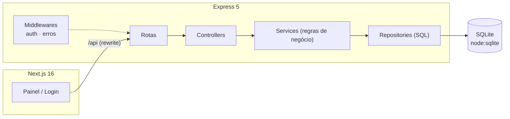

# Core Access Manager

[](https://github.com/brenoluizdev/core-access-manager/actions/workflows/ci.yml)


Sistema fullstack de gerenciamento de usuários com autenticação JWT, controle de
permissões por perfil (RBAC) e arquitetura em camadas — API em Node.js/TypeScript e
painel web em Next.js.

---

## O problema

Quase todo sistema interno precisa resolver as mesmas perguntas antes de crescer:

- Quem pode criar, editar, desativar e excluir usuários?
- Como impedir que um usuário comum altere o próprio perfil de acesso?
- Onde ficam as regras de autorização, para não duplicá-las em cada rota?
- Como testar isso sem subir banco, Docker ou um ambiente inteiro?

Este projeto responde a essas perguntas com uma base pequena, mas com as decisões
que costumam ser deixadas para depois: separação de camadas, regras de negócio
testáveis, erros padronizados e validação na borda.

## O que está implementado

- Cadastro e login com senha protegida por **scrypt** (salt por usuário).
- Autenticação por **JWT** com expiração configurável.
- **RBAC** com dois perfis (`ADMIN` e `USER`) aplicado em middleware, não na rota.
- CRUD de usuários com paginação, busca e filtros.
- Regras de integridade: e-mail único, conta desativada não autentica, ninguém
  desativa ou exclui a própria conta, usuário comum não se promove a ADMIN.
- Erros padronizados em JSON (`code` + `message` + `details`), com status HTTP correto.
- 45 testes de integração e unidade cobrindo os fluxos acima.
- Painel web com login, listagem paginada, busca, cadastro, ativação/desativação e exclusão.

## Stack

| Camada | Tecnologia |
| --- | --- |
| API | Node.js 22+, Express 5, TypeScript (strict) |
| Autenticação | JWT (`jsonwebtoken`) + scrypt nativo (`node:crypto`) |
| Persistência | SQLite via `node:sqlite` (nativo, sem módulo compilado) |
| Validação | Validadores próprios, tipados, sem dependência externa |
| Testes | Vitest + Supertest + cobertura V8 |
| Web | Next.js 16 (App Router), React 19, Tailwind CSS 4 |
| Infra | Docker multi-stage + Docker Compose (volume persistente) |
| CI | GitHub Actions (matriz Node 22/24 + lint/build do frontend) |

## Arquitetura



Cada camada tem uma responsabilidade única:

- **Rotas** só declaram caminho e quais middlewares se aplicam.
- **Controllers** traduzem HTTP: leem `req`, chamam o serviço, devolvem status e JSON.
- **Services** concentram as regras de negócio e lançam `AppError` com status semântico.
- **Repositories** são os únicos que conhecem SQL.
- **Middlewares** cuidam de autenticação, autorização e tradução de erros.

O resultado prático: as regras de permissão são testáveis sem HTTP, e o HTTP é
testável sem banco externo.

### Modelo de permissões

| Ação | `USER` | `ADMIN` |
| --- | :---: | :---: |
| Ver e editar o próprio perfil | ✅ | ✅ |
| Trocar a própria senha | ✅ | ✅ |
| Listar todos os usuários | ❌ | ✅ |
| Ver o perfil de outra pessoa | ❌ | ✅ |
| Criar usuários | ❌ | ✅ |
| Alterar perfil ou status de alguém | ❌ | ✅ |
| Excluir usuários | ❌ | ✅ |
| Desativar/excluir a própria conta | ❌ | ❌ |

## Como rodar

Pré-requisito: **Node.js 22.5+** (por causa do `node:sqlite`).

### API

```bash
cd backend
cp .env.example .env     # ajuste o JWT_SECRET
npm install
npm run dev              # http://localhost:3333/api
```

### Painel web

```bash
cd frontend
npm install
npm run dev              # http://localhost:3000
```

O painel conversa com a API através de um rewrite (`/api/*` → `localhost:3333`),
então não há configuração de CORS. Para apontar para outra API, defina `API_URL`.

> O **primeiro usuário cadastrado vira ADMIN** automaticamente. Os seguintes entram
> como `USER` e só podem ser promovidos por um administrador.

### Docker (API + painel)

Sobe os dois serviços com um comando, sem instalar Node:

```bash
cp .env.example .env   # troque o JWT_SECRET antes de expor o serviço
docker compose up --build
```

- Painel: <http://localhost:3000>
- API: <http://localhost:3333/api>
- O SQLite fica no volume `api-data`, então os dados sobrevivem a `docker compose down`.

A imagem da API é multi-stage, roda como usuário `node` e tem healthcheck em
`/api/health`. A do painel usa o output `standalone` do Next, o que dispensa
`node_modules` na imagem final. A URL da API é resolvida no build (build arg
`API_URL`, padrão `http://api:3333`).

## API

| Método | Rota | Acesso | Descrição |
| --- | --- | --- | --- |
| `GET` | `/api/health` | público | Health check |
| `POST` | `/api/auth/register` | público | Cadastro (primeiro usuário = ADMIN) |
| `POST` | `/api/auth/login` | público | Login, devolve `token` + `user` |
| `GET` | `/api/auth/me` | autenticado | Usuário do token |
| `GET` | `/api/users` | `ADMIN` | Lista paginada (`page`, `perPage`, `search`) |
| `GET` | `/api/users/:id` | `ADMIN` ou o próprio | Detalhe de um usuário |
| `POST` | `/api/users` | `ADMIN` | Cria usuário |
| `PATCH` | `/api/users/:id` | `ADMIN` ou o próprio | Atualiza campos |
| `DELETE` | `/api/users/:id` | `ADMIN` | Remove usuário |

Exemplo:

```bash
# 1. cria o primeiro usuário (ADMIN)
curl -X POST http://localhost:3333/api/auth/register \
  -H "Content-Type: application/json" \
  -d '{"name":"Breno","email":"breno@example.com","password":"senha-segura-123"}'

# 2. usa o token retornado
curl http://localhost:3333/api/users \
  -H "Authorization: Bearer <token>"
```

## Testes

```bash
cd backend
npm test              # 45 testes
npm run test:coverage # relatório de cobertura
```

Cobertura atual: **~90% de linhas**, **~85% de branches**, **~98% de funções**.
O CI roda a suíte em Node 22 e 24, além de `tsc --noEmit` e `npm run build`.

Os testes usam um banco SQLite em memória (`DATABASE_FILE=:memory:`), então não
dependem de Docker, Postgres ou rede.

## Estrutura

```
backend/
  src/
    config/        env + conexão/migração do SQLite
    middlewares/   autenticação, autorização e tratamento de erros
    modules/
      auth/        cadastro, login e /me
      users/       model, repository, service, controller e rotas
    utils/         hash (scrypt), jwt e validação
  tests/           integração (Supertest) + unidade
frontend/
  app/             painel (login, listagem, CRUD)
```

## Decisões técnicas

- **`node:sqlite` em vez de ORM:** o projeto é pequeno e o SQL é explícito. Isso
  elimina dependências nativas e deixa o teste instantâneo. Se o domínio crescer,
  o repository é o único ponto a trocar.
- **scrypt em vez de bcrypt:** é nativo do Node, resistente a GPU e não exige
  compilação de binário no Windows/CI.
- **Autorização em middleware + service:** o middleware barra cedo (403), e o
  service revalida as regras de negócio (ex.: não se auto-promover). Defesa em
  profundidade: uma rota nova não abre brecha por esquecimento.
- **Mesma mensagem para e-mail inexistente e senha errada:** evita enumeração de
  contas.
- **Erros como `AppError`:** o status HTTP nasce na camada de negócio, não no
  controller, o que mantém a API consistente.

## Roadmap

- [ ] Refresh token e revogação de sessão
- [ ] Testes E2E do painel (Playwright)
- [ ] Docker Compose (API + Postgres) para deploy
- [ ] Auditoria de alterações (quem mudou o quê)

---

Feito por [Breno Luiz](https://github.com/brenoluizdev) · [LinkedIn](https://www.linkedin.com/in/brenoluizdev/)
